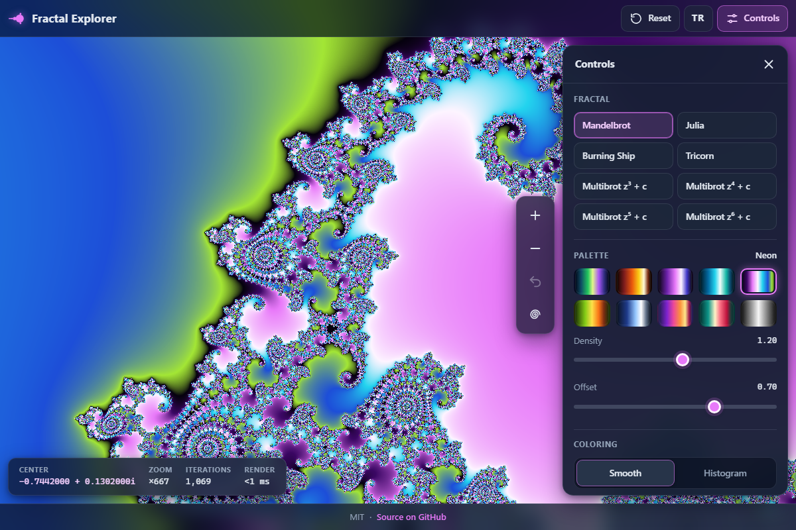

# Fractal Explorer - an endless zoom into the Mandelbrot set, Julia sets and their relatives, right in your browser

[](#tests)
[](LICENSE)

**▶ Open the app: https://celaldrg.github.io/fractal-explorer/**



## Features

- Eight fractal families: Mandelbrot, Julia (any c), Burning Ship, Tricorn and Multibrot z^d + c for d = 3 to 6.
- Progressive rendering on a pool of Web Workers (one per spare CPU core, up to 8): a coarse preview first, then sharper passes, tiles from the centre outwards, with a thin progress bar.
- Smooth (continuous) or histogram coloring, 10 original cyclic palettes, density and offset sliders.
- An iteration limit that grows as you zoom in, or a manual value from 16 to 50,000.
- Julia picker: move over the Mandelbrot set and a live mini preview in the corner shows the Julia set of the point under the pointer; click or lift your finger to open it.
- 10 famous places with thumbnails and short descriptions: Seahorse Valley, Elephant Valley, a spiral, a mini Mandelbrot, five Julia sets and a small ship on the antenna of the Burning Ship.
- Back button for zoom steps, save as PNG, and a share link in the URL hash (fractal, centre, scale, palette, density, offset, coloring, iteration limit and c).
- Info bar with centre, zoom factor, iterations and render time; a notice when double precision runs out (view width below about 1e-13).
- Made for phones too: touch gestures, a bottom-sheet drawer, a sharp canvas on high-DPI screens.
- English and Turkish interface; the language and your palette, coloring and iteration settings are remembered on your device.
- No dependencies, no build step, no network requests: plain HTML, CSS and ES modules.

## How to use

| Action | Mouse and keyboard | Touch |
| --- | --- | --- |
| Pan | drag, or the arrow keys | drag with one finger |
| Zoom around a point | mouse wheel | pinch with two fingers |
| Zoom in 2× | double-click, `+` or the + button | double-tap or the + button |
| Zoom out 2× | `-` or the − button | the − button |
| Zoom box | Shift-drag | – |
| Undo zoom steps | `Backspace` or the Back button | the Back button |
| Reset the view | `0` or Reset | Reset |
| Julia set of the point at the centre, and back | `J` or the spiral button | the spiral button |
| Leave the Julia picker | `Esc` | the picker button again |

**Controls** (top right) opens the drawer: fractal type, palette, density, offset, coloring, iteration limit, the Julia picker and the exact value of c, famous places, Save PNG and Copy link. **TR / EN** switches the language.

To pick a Julia set, press **Pick c on the Mandelbrot set**, then hover or drag over the set: the corner preview follows the pointer, and a click (or lifting your finger) opens the Julia set of that point.

## Run locally

Serve the folder with any static web server, for example:

```sh
npx serve .
```

Then open the address it prints (for example http://localhost:3000). ES modules and module workers only load over http://, so opening `index.html` straight from disk (file://) does not work.

## Tests

```sh
node --test
```

Uses the built-in test runner of Node.js 22 (the version CI uses); there is nothing to install. The tests cover:

- the escape-time engine: Mandelbrot membership (0, −1, i and −2 stay bounded; 1 and −2.01 escape), the main-cardioid and period-2-bulb checks, smooth counts against a reference formula, the c = 0 Julia set as the unit circle, and Burning Ship and Tricorn against a naive loop pixel for pixel;
- the view model: pixel ↔ complex round trips, panning, zooming, the zoom box, clamping and the precision notice;
- the tile scheduler: every pixel of a 1000×700 image covered exactly once, coarse-to-fine passes, centre-out order, and a worker pool that still draws every tile (and warns once) when its workers fail;
- palettes and coloring: periodic, interpolating lookups, density, offset and the histogram, also when it is switched on before the first pass is done;
- famous places, settings and the share-link hash, the explorer state and its zoom history, storage that survives blocked localStorage;
- UI helpers: keys, wheel, pinch and tap detection, canvas and worker limits, number formatting, and the English and Turkish string tables.

## Project structure

```text
fractal-explorer/
├── index.html, style.css      page and styles
├── src/
│   ├── fractals.js, render.js, tiles.js, view.js         escape-time engine, tiles, view model
│   ├── palettes.js, color.js, places.js                  palettes, coloring, famous places
│   ├── settings.js, explorer.js, storage.js              settings, share hash, state, storage
│   ├── main.js, renderer.js, worker-pool.js, render-worker.js   page wiring, progressive rendering
│   ├── drawer.js, pointer.js, preview.js, thumbnails.js  controls, gestures, Julia preview, place thumbnails
│   └── input.js, display.js, format.js, i18n.js, paint.js, dom.js   small helpers, EN/TR strings
├── test/                      node --test suites
└── docs/screenshot.png
```

## License

MIT, see [LICENSE](LICENSE).

## Türkçe

**▶ Uygulamayı aç: https://celaldrg.github.io/fractal-explorer/**

Mandelbrot kümesine, Julia kümelerine ve akrabalarına tarayıcıda, sonu gelmeyen bir yakınlaştırma.

### Özellikler

- Sekiz fraktal ailesi: Mandelbrot, Julia (her c için), Yanan Gemi (Burning Ship), Üç Köşe (Tricorn) ve d = 3–6 için Multibrot z^d + c.
- Web Worker havuzunda kademeli çizim (boşta kalan her işlemci çekirdeği için bir worker, en çok 8): önce kaba bir önizleme, sonra keskinleşen geçişler; karolar merkezden dışa doğru, ince bir ilerleme çubuğuyla.
- Yumuşak (sürekli) ya da histogram renklendirme, 10 özgün döngüsel palet, yoğunluk ve kaydırma sürgüleri.
- Yaklaştıkça artan bir yineleme sınırı ya da 16 ile 50.000 arasında elle girilen bir değer.
- Julia seçici: Mandelbrot kümesinin üzerinde gezinirken köşedeki canlı önizleme imlecin altındaki noktanın Julia kümesini gösterir; tıklayınca ya da parmağınızı kaldırınca o küme açılır.
- Küçük resimli ve kısa açıklamalı 10 ünlü yer: Denizatı Vadisi, Fil Vadisi, bir sarmal, bir mini Mandelbrot, beş Julia kümesi ve Yanan Gemi'nin antenindeki küçük bir gemi.
- Yakınlaştırma adımları için Geri düğmesi, PNG olarak kaydetme ve URL hash'inde paylaşım bağlantısı (fraktal, merkez, ölçek, palet, yoğunluk, kaydırma, renklendirme, yineleme sınırı ve c).
- Merkez, yakınlaştırma katsayısı, yineleme ve çizim süresini gösteren bilgi çubuğu; çift duyarlık yetmez olunca (görünüm genişliği yaklaşık 1e-13'ün altında) bir uyarı.
- Telefona da uygun: dokunma hareketleri, alttan açılan ayar paneli, yüksek DPI ekranlarda keskin tuval.
- İngilizce ve Türkçe arayüz; dil, palet, renklendirme ve yineleme ayarları cihazınızda hatırlanır.
- Bağımlılık yok, derleme adımı yok, ağ isteği yok: düz HTML, CSS ve ES modülleri.

### Nasıl kullanılır

| İşlem | Fare ve klavye | Dokunma |
| --- | --- | --- |
| Kaydırma | sürükleme ya da ok tuşları | tek parmakla sürükleme |
| Bir noktanın çevresinde yakınlaştırma | fare tekerleği | iki parmakla sıkıştırma |
| 2 kat yaklaştırma | çift tıklama, `+` ya da + düğmesi | çift dokunma ya da + düğmesi |
| 2 kat uzaklaştırma | `-` ya da − düğmesi | − düğmesi |
| Yakınlaştırma kutusu | Shift ile sürükleme | – |
| Yakınlaştırma adımlarını geri alma | `Backspace` ya da Geri düğmesi | Geri düğmesi |
| Görünümü sıfırlama | `0` ya da Sıfırla | Sıfırla |
| Ekran merkezindeki noktanın Julia kümesi ve geri dönüş | `J` ya da sarmal düğmesi | sarmal düğmesi |
| Julia seçiciden çıkma | `Esc` | seçici düğmesine yeniden basma |

Sağ üstteki **Ayarlar** paneli açar: fraktal türü, palet, yoğunluk, kaydırma, renklendirme, yineleme sınırı, Julia seçici ve c'nin tam değeri, ünlü yerler, PNG kaydet ve Bağlantıyı kopyala. **TR / EN** dili değiştirir.

Bir Julia kümesi seçmek için **c'yi Mandelbrot kümesinden seç** düğmesine basın, sonra kümenin üzerinde gezinin ya da sürükleyin: köşedeki önizleme imleci izler; tıklayınca (ya da parmağınızı kaldırınca) o noktanın Julia kümesi açılır.

### Yerelde çalıştırma

Klasörü herhangi bir statik web sunucusuyla açın, örneğin:

```sh
npx serve .
```

Sonra yazdığı adresi açın (örneğin http://localhost:3000). ES modülleri ve modül worker'ları yalnız http:// üzerinden yüklenir; `index.html` dosyasını diskten (file://) doğrudan açmak çalışmaz.

### Testler

```sh
node --test
```

Node.js 22'nin yerleşik test koşucusunu kullanır (CI'daki sürüm); kurulacak bir şey yok. Testlerin kapsadıkları:

- kaçış zamanı motoru: Mandelbrot üyeliği (0, −1, i ve −2 sınırlı kalır; 1 ve −2,01 kaçar), ana kardiyoit ve 2. periyot balonu denetimleri, başvuru formülüne karşı yumuşak sayımlar, birim çember olarak c = 0 Julia kümesi, Yanan Gemi ve Üç Köşe'nin saf bir döngüyle piksel piksel karşılaştırılması;
- görünüm modeli: piksel ↔ karmaşık sayı gidiş-dönüşleri, kaydırma, yakınlaştırma, yakınlaştırma kutusu, sınırlama ve duyarlık uyarısı;
- karo planlayıcı: 1000×700 bir resmin her pikseli tam bir kez, kabadan inceye geçişler, merkezden dışa sıra ve worker'lar çökünce de her karoyu çizen (ve bir kez uyaran) worker havuzu;
- paletler ve renklendirme: döngüsel, ara değer bulan aramalar, yoğunluk, kaydırma ve ilk geçiş bitmeden açılsa da histogram;
- ünlü yerler, ayarlar ve paylaşım hash'i, gezgin durumu ve yakınlaştırma geçmişi, localStorage engelliyken de çalışan depolama;
- arayüz yardımcıları: tuşlar, tekerlek, sıkıştırma ve dokunma algılama, tuval ve worker sınırları, sayı biçimleri, İngilizce ve Türkçe metin tabloları.

### Lisans

MIT, bkz. [LICENSE](LICENSE).
